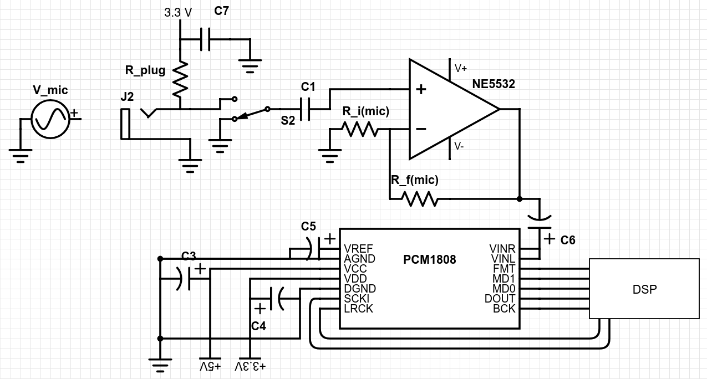
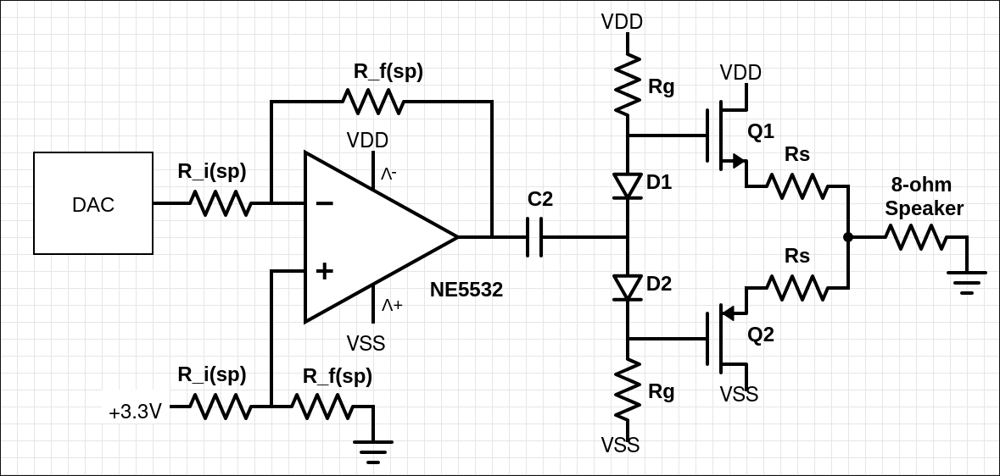

# hardware-autotune

I'm re-creating the autotune effect using digital circuits. When complete, I plan to have a device that can connect to a microphone, and includes an onboard speaker with the option to connect earphones/headphones instead. The user will speak into the microphone, the circuit I made with HDL is gonna apply autotune, and then the result will playback on the speaker.

## Analog Circuit Design

This section will cover the design of the recording and playback analog circuits. I specifically left component values unknown as I they depend on certain specifications that I haven't decided yet. UPDATE: the previous sentence is no longer true.

For info on the digital implementations of autotune and other effects, see the following links:

- WIP

### Recording

Above is the circuit diagram detailing how microphone input will be processed before reaching the ADC, and then the DSP. Assume all connections to the DSP have $100 \Omega$ resistors.

1. We start at the voltage source labelled $V_{mic}$, this represents the microphone which converts your voice into an AC waveform with a very small amplitude. Microphones typically require a small amount of plug in power, so we connect the microphone to our $3.3 V$ source, with a resistor to limit current, and a capacitor to shunt noise to GND. J1 is a headphones jack that will close this circuit.
2. Switch $S_1$ acts as an on/off switch for accepting microphone input. When in the downwards OFF position, the ADC should receive a constant $0 V$. In the upwards ON position, it should allow our microphone signal to pass to the next stage.
3. Because the DC plug in power is on the same line as the AC output, we place a capacitor $C_2$ to recenter our AC waveform at $0 V$. 
4. Here we pass our microphone signal through a non-inverting amplifier circuit to get it to the ADC's desired amplitude. We require two amplifiers in case a large gain needs to be applied. Luckily, the TL072 chip has two amplifiers built in.
5. Now, our signal is ready to pass through the ADC and be processed by the DSP. The ADC was wired up according to the [datasheet](docs/pcm1808.pdf) under the section "Application and Implementation".

Component Values:

- Amplifier supply: $+5 V$ and $-5 V$
- $R_{plug}$: $2.2 k\Omega$
- $C_1$: $10 \mu\text{F}$ Aluminum Electrolytic
- $C_2$: $10 \mu\text{F}$ Aluminum Electrolytic
- $R_b$: $10 k\Omega$
- $R_{i(mic)}$: $2.4 k\Omega$
- $R_{f(mic)}$: $10 k\Omega$
- $R_{i2(mic)}$: $2.4 k\Omega$ 
- $R_{f2(mic)}$: $8.2 k\Omega - 18.2 k\Omega$
- $C_3$: $0.1 \mu\text{F}$ Ceramic, $10 \mu\text{F}$ Aluminum Electrolytic
- $C_4$: $1 \mu\text{F}$ Aluminum Electrolytic
- $C_5$: $0.1 \mu\text{F}$ Ceramic, $10 \mu\text{F}$ Aluminum Electrolytic
- $C_6$: $0.1 \mu\text{F}$ Ceramic, $10 \mu\text{F}$ Aluminum Electrolytic

How I landed on the amplifier resistor values:

I found out that microphones that plug into a 3.50 mm jack typically output a maximum signal amplitude of $50 mV$-$100 mv$. Knowing from the [ADC's datasheet](docs/pcm1808.pdf) that the input voltage must be $3 V_{pp}$ at the most, I calculated the minimum gain for a single stage if the mic were outputting the largest amplitude. Then, I simply picked resistor values that would get me a good bit under that gain if the variable resistor were set to $0 \Omega$, and a good bit above if set to $10 k\Omega$.

I did calculations to land on many of the other component values, but they're honestly not that interesting.

Important:

- $C_3$, $C_5$, and $C_6$ should be placed as close as possible to their respective pins.

### Playback

Above is the circuit diagram detailing how our DSP's digital output will be processed in order to be played on analog speakers. Assume all connections to the DSP have $100 \Omega$ resistors.

1. The DSP feeds digital input data representing our audio into the DAC, which converts it into an analog waveform. I specifically left $H_{out}R$ disconnected because we're dealing with mono sound. The DAC was wired up according to the [datasheet](docs/sles011e.pdf) under the section "Application Information".
2. At the DAC output, our signal is going to be $1.24 V_{pp}$ centered at $0.62 V$, we send our signal through a capacitor to recenter it at $0 V$. Also, we use an RC high-pass filter to attenuate the high frequency switching noise.
4. The signal reaches a junction where the top amplifier brings it to the amplitude required to be played on the onboard speaker, while the bottom one is simply there to prevent the headphones from altering the cutoff frequency of the preceeding high-pass filter. However, I chose a different amplifier due to increased current requirements.
5. While our signal has the amplitude required, it lacks the current needed to produce loud and rich audio. We use two source follower amplifiers, one for the positive half-cycle, and one for the negative. The diodes bias these transistors so that they are held at the edge of saturation, which is required to prevent crossover distortion. I specifically chose source follower amplifiers because the gain is unity, keeping our signal at the amplitude we like.
6. Now our audio signal is ready to be played on the speaker. Speakers can be modelled by an $8 \Omega$ impedance, showcasing their high current demands. This speaker will be onboard.

Component Values:

- Amplifier supply: $+5 V$ and $-5 V$
- $R_{i(sp)}$: $3.3 k\Omega$
- $R_{f(sp)}$: $5 k\Omega - 15 k\Omega$ (Adjustable)
- $V_{DD}$: $+5 V$
- $V_{SS}$: $-5 V$
- $C_1$: $10 \mu\text{F}$ Aluminum Electrolytic
- $C_2$: $10 \mu\text{F}$ Aluminum Electrolytic
- $R_b$: $10 k\Omega$
- $C_3$: $100 nF$ Ceramic
- $R_g$: $100 \Omega$
- $R_s$: $0.47 \Omega$, $1 W$

I followed a similar process to the recording circuit to land on the amplifier resistors' values in this circuit, as well as for other values.

Important: 

- $C_3$ MUST be placed as close as humanly possible to the $V_{cc}$ and $V_{HP}$ pins. Yes that means two capacitors. Same goes for $C_1$.
- Both $R_g$ MUST be placed as close to the gate of the respective MOSFET as possible.

### Part Sources

WIP

Need LDOs for $3.3 V$ and $2.4 V$ rails.

External RAM module: Microchip 23LC1024

## Digital Design

### Memory Map

This project will use two external RAM modules:

- RAM0: Connected to both resampling and pitch detection which will contain the input, output, and circular buffers
- RAM1: Connected to just pitch detection which will contain the current frame, autocorrelation values, etc.

Memory map for RAM0:

| Region Name	    | Start Address (Hex)   | End Address (Hex) | Length (Bytes)    | Length (Hex)  | Description               |
| ----------------- | --------------------- | ----------------- | ----------------- | ------------- | ------------------------- | 
| Reserved	        | 0x000                 | 0x00F             | 16                | 0x010         | Reserved system space     |     
| Input Buffer	    | 0x010	                | 0x40F	            | 1,024	            | 0x400	        | Input data buffer region  |
| Output Buffer     | 0x410                 | 0x80F             | 1,024	            | 0x400	        | Output data buffer region |
| Circular Buffer   |	0x810               | 0x480F            | 16,384            | 0x4000        | Circular buffer region    |

Memory map for RAM1:

| Region Name	    | Start Address (Hex)   | End Address (Hex) | Length (Bytes)    | Length (Hex)  | Description               |
| ----------------- | --------------------- | ----------------- | ----------------- | ------------- | ------------------------- | 
| Reserved	        | 0x000                 | 0x00F             | 16                | 0x010         | Reserved system space     |     
| Note Freq LUT	    | 0x010	                | 0x10F	            | 	256            | 	 0x100       | Table of note frequencies  |
| Frame Buffer 1     | 0x200                 | 0x1FFF              | 7680	            | 0x1E00 	        | Signal frame to be processed by pitch detection. |
| Frame Buffer 2     | 0x2000                 | 0x3DFF              | 7680 	            | 0x1E00 	        | Signal frame to be processed by pitch detection. |

> [!NOTE]
> You'll notice there are two frame buffers. The reason for this is so that while one is being built, the other one can be processed. Had we overwritten the same one while processing, our results would get corrupted.
> Once a frame buffer has been processed, we swap the pointers for the processed one and the one being built.

### Parameters

- Bit width: 24
- Format: 12.12 Fixed-point
- BLOCK_SIZE: 16 samples
- F_MAX: 800 Hz
- F_MIN: 50 Hz
- SAMPLE_RATE: 48000 Hz
- TAU_MAX: SAMPLE_RATE / F_MIN = 960
- TAU_MIN: SAMPLE_RATE / F_MAX = 60
- FRAME_WIDTH: 2*SAMPLE_RATE/F_MIN = 1920 samples
- WINDOW_SIZE: FRAME_WIDTH / 2 = 960 samples

### High Level Design

There's two major sections of this design:

1. Resampling 
2. Pitch Detection + Note matching

Resampling follows this flow:

1. The ADC is ready to send a sample, signalling the I2S Rx Slave module.
2. The input handler receives the sample and writes it to a circular buffer located in an external SPI memory module.
3. After BLOCK_SIZE samples have been written, we have time until the next tick of LRCK to read, resample, and write samples to the output buffer in the same SPI memory module.
4. An output handler reads the output buffer and send samples to the DAC using an I2S Tx Slave.

Pitch Detection follows this flow:

1. From step two of resampling, the sample is also directed to the butterworth bandpass filter.
2. After passing through the filter, the sample is written to another memory module.
3. When a start signal is pulsed, YIN pitch detection is performed on the frame.
4. Once the pitch is determined, the nearest note and the ratio is determined by reading the note frequencies LUT.
5. Both the current pitch, and ratio are outputted so that resampling knows what speed to sample at.

Because pitch detection uses its own ram module, its able to operate in parallel with resampling. This prevents us from having to squeeze both resampling and pitch detection in the narrow time between the BLOCK_SIZE'th sample, and the next sample.

### Operation Breakdown

#### Startup/Configuring

For startup, the only operations we really perform is generating the frequency table. In a cycle we perform:

- 1 magnitude comparison (note_matching.py:50)
- 1 multiply (note_matching.py:54,56)
- 1 add (note_matching.py:57)

This is repeated a maximum of 56 times (in the case that the scale is set to chromatic).

#### Resampling

First we step the write head:

- BLOCK_SIZE incrementations
- BLOCK_SIZE magnitude comparisons

Next, we binary search for the note.

- Max 2*log(56) magnitude comparisons
- Potentially a single multiply, square root, and magnitude comparison
- 1 division to determine the shift
- 1 division to determine the samples for one vocal period

Next, we check for an underrun:

- 1 addition
- 5 magnitude comparisons
- 1 modulo
- An addition and modulo if an underrun occurred

Finally, we resample repeating the following operations BLOCK_SIZE times:

- 3 additions
- 1 subtraction
- 4 magnitude comparisons
- 2 modulos
- 1 addition, 5 magnitude comparisons, 1 modulo (check overrun)
- Two additions and modulos if an overrun occurred.

#### Pitch Detection

- (window_size * tau_max) + (4 * tau_max) - 1 additions/subtractions
- (window_size * tau_max) + (4 * tau_max) - 2 multiplications
- 2 * tau_max divisions
- 4 * (tau_max - tau_min) comparisons (worst-case scenario)

I can optimize this by storing prior autocorrelation for each lag.

## Ideas for the Future

**May 26, 2026:** I'm considering adding more effects than just autotune, and enabling profile creation too. My friend also gave me a pretty good idea of printing this using TinyTapeout, it'd be sick to have my very own ASIC that I designed all on my own. 

**May 27, 2026:** I feel like its useful for a project like this to have options for input/output. My plan is to use a 3.5mm audio jack for the mic input, and another 3.5mm audio jack directly after the DAC so that active speakers (like the ones in headphones) can hear the audio. The onboard 8-ohm passive speaker will still be there as it gives me a reason to design my own audio amp.

**June 8, 2026:** It might be useful to make certain resistors (like feedback ones for amplifiers) adjustable so that I can calibrate the device on the fly. With them I could adjust volume, and also separate different frequency bands using filters and apply individual gains to them (I think this is what an equalizer does).
